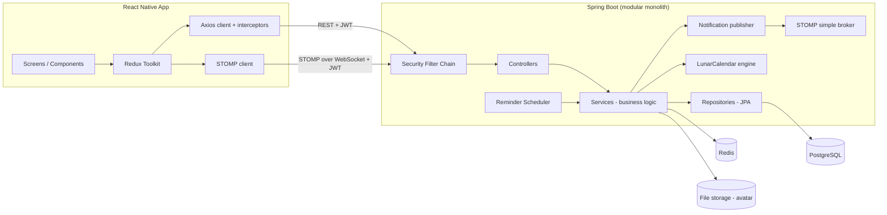
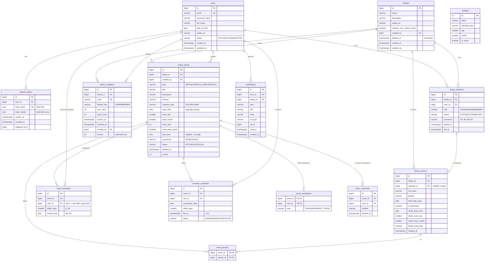

# FamilyHub — PHASE 1: Product Architecture

> Trạng thái: **BẢN ĐỀ XUẤT — chờ xác nhận**. Chưa có dòng code nào được viết. Mọi quyết định dưới đây có thể điều chỉnh trước khi sang Phase 2/3.

---

## 1. Phân tích sản phẩm

### 1.1. Vấn đề cốt lõi
Thông tin quan trọng của gia đình (sinh nhật, ngày giỗ theo âm lịch, ngày cưới, họp mặt) nằm rải rác trong trí nhớ, sổ tay, nhóm chat. Hệ quả: quên ngày, chỉ một người nắm thông tin, con cháu không biết ngày giỗ ông bà.

### 1.2. Giá trị khác biệt
| Điểm | Vì sao quan trọng |
|---|---|
| **Âm lịch chính xác** (giỗ, Tết, rằm) | Google Calendar không hỗ trợ lặp lại theo âm lịch Việt Nam. Đây là "killer feature". |
| **Lịch theo gia đình**, quyền theo gia đình | Một người ở nhiều gia đình (nhà nội, nhà ngoại, gia đình nhỏ) với vai trò khác nhau. |
| **Hồ sơ người thân không cần tài khoản** | Ông bà đã mất, trẻ nhỏ không có tài khoản nhưng vẫn cần ngày giỗ / sinh nhật. |
| **Nhắc nhở đúng giờ Việt Nam, không trùng lặp** | Lịch nhắc tính theo `Asia/Ho_Chi_Minh`, có cơ chế idempotent. |

### 1.3. Phát hiện quan trọng khi phân tích
1. **Người liên quan đến sự kiện ≠ User.** Ngày giỗ ông nội gắn với *ông nội* — người không có tài khoản. Vì vậy cần thêm entity **`FamilyPerson`** (hồ sơ người thân), có thể liên kết tùy chọn với một `FamilyMember`. Đây cũng là nền móng cho tính năng gia phả sau này.
2. **"Thành viên liên quan" ≠ "Người tham gia".** `EventPerson` = sự kiện nói về ai (sinh nhật của bé An). `EventParticipant` = ai xác nhận đi (RSVP, Module 5). Tách hai bảng để không lẫn nghĩa.
3. **Ngày lễ là dữ liệu hệ thống**, không thuộc gia đình nào → bảng `holidays` riêng, seed bằng Flyway (không hardcode trong code).
4. **Sự kiện lặp lại không lưu từng lần xảy ra** (occurrence) mà tính khi truy vấn; chỉ lưu *lịch nhắc đã lên kế hoạch* để đảm bảo không gửi trùng.

---

## 2. Đánh giá tính khả thi

| Hạng mục | Độ khó | Nhận định |
|---|---|---|
| Auth + JWT + Refresh rotation | Trung bình | Phổ biến, có nhiều tài liệu. |
| Phân quyền theo gia đình (resource-based) | Trung bình–Cao | Điểm nhấn khi phỏng vấn; cần thiết kế cẩn thận để chống IDOR. |
| Chuyển đổi âm lịch Việt Nam | **Cao** | Rủi ro lớn nhất về đúng/sai. Có thuật toán công khai, kiểm thử được. |
| Sự kiện lặp âm lịch + nhắc nhở | **Cao** | Phải xử lý tháng nhuận, tháng thiếu, vắt năm. |
| WebSocket STOMP + JWT | Trung bình | Cần xác thực ở frame CONNECT và kiểm quyền khi SUBSCRIBE. |
| React Native CLI + lịch tùy biến | Trung bình–Cao | Cấu hình native Android/iOS tốn thời gian ban đầu. |

**Kết luận:** Khả thi cho 1 người trong khoảng **12–16 tuần** (làm bán thời gian), nếu giữ đúng phạm vi MVP.

---

## 3. Phạm vi MVP và mở rộng

### 3.1. MVP (bắt buộc hoàn thành)
- **Auth:** đăng ký, đăng nhập, đăng xuất, refresh token (rotation), xem/sửa hồ sơ, đổi mật khẩu, upload avatar (lưu local).
- **Family:** tạo, sửa, xem thành viên, mời bằng mã, tham gia bằng mã, rời, giải tán (OWNER), đổi vai trò, xóa thành viên, **chuyển quyền OWNER**.
- **FamilyPerson:** hồ sơ người thân (còn sống / đã mất), liên kết tùy chọn với thành viên.
- **Calendar:** CRUD sự kiện 6 loại; dương lịch + âm lịch; lặp hằng năm; xem tháng / ngày / danh sách sắp tới; API trả thông tin âm lịch cho từng ô lịch; ngày lễ hệ thống.
- **Reminder & Notification:** nhắc mặc định theo sự kiện + tùy chỉnh theo người dùng; scheduler; thông báo trong app; realtime qua WebSocket STOMP; đánh dấu đã đọc.
- **Mobile:** 15 màn hình đã liệt kê, tích hợp API thật.

### 3.2. Mở rộng (sau MVP)
| Tính năng | Ghi chú |
|---|---|
| Module 5 — Activities (họp mặt, RSVP, bình luận) | Schema đã chừa chỗ (`event_participants`, `event_comments`). |
| Xem theo tuần | Ít giá trị với lịch gia đình, làm sau tháng/ngày. |
| Lặp hằng tháng âm lịch (mùng 1, rằm) | Rất hợp văn hóa Việt; thuật toán dùng chung. |
| Push notification (FCM/APNs) | Thêm kênh gửi mới cho cùng một bảng lịch nhắc. |
| Duyệt yêu cầu tham gia gia đình | Cờ `require_approval` ở family. |
| Gia phả (cây quan hệ) | Dựa trên `family_persons` + bảng quan hệ. |
| Lưu ảnh S3/MinIO | Qua interface `StorageService` đã có từ MVP. |
| Đa instance (ShedLock, STOMP broker relay) | Khi triển khai nhiều server. |

---

## 4. Kiến trúc tổng thể

### 4.1. Lựa chọn: **Modular Monolith** (khuyến nghị)

| Phương án | Ưu | Nhược |
|---|---|---|
| **Modular Monolith** ✅ | Một codebase, một DB, transaction đơn giản, deploy dễ; vẫn tách module rõ để trình bày. | Phải giữ kỷ luật ranh giới module. |
| Microservices | "Nghe" hiện đại. | Quá tải cho 1 người: distributed transaction, service discovery, nhiều DB. Phỏng vấn viên sẽ hỏi "vì sao cần?" và khó trả lời. |
| Layered monolith thuần (package theo tầng) | Đơn giản nhất. | Khi lớn lên, `service/` chứa 40 class lẫn lộn, khó nói về ranh giới nghiệp vụ. |

Lý do chọn: đủ chiều sâu (ranh giới module, event nội bộ, phân quyền), nhưng không tạo phức tạp giả tạo. Có thể tách service sau nếu thật sự cần.

### 4.2. Sơ đồ



### 4.3. Các quyết định kỹ thuật chính

| Chủ đề | Quyết định | Lý do |
|---|---|---|
| Xác thực | Access token JWT 15 phút + Refresh token opaque 14 ngày, **lưu hash** trong DB, **rotation** + phát hiện tái sử dụng | Refresh token bị lộ sẽ bị phát hiện khi dùng lại; DB chỉ chứa hash nên lộ DB không lộ token. |
| Đăng xuất | Thu hồi refresh token; jti của access token đưa vào Redis blacklist đến khi hết hạn | Đăng xuất có hiệu lực ngay, không phải đợi 15 phút. |
| Phân quyền | Role nằm ở `family_members` (không ở `users`). Kiểm tra bằng `FamilyAccessService` + `@PreAuthorize("@familyAccess.hasRole(#familyId, 'ADMIN')")` | Resource-based authorization; một người có vai trò khác nhau ở mỗi gia đình. |
| Chống IDOR | Mọi truy vấn tài nguyên con đều kèm `familyId`: `findByIdAndFamilyId(eventId, familyId)`; không tìm thấy → **404** (không lộ sự tồn tại) | Ngăn đoán `eventId` của gia đình khác. |
| Thời gian | Thời điểm (`created_at`, `fire_at`) lưu `TIMESTAMPTZ` (luôn ở **UTC**); ngày sự kiện lưu `DATE` (không có giờ); mọi tính toán "hôm nay" dùng `ZoneId.of("Asia/Ho_Chi_Minh")` qua một `Clock` bean | `Clock` cho phép test giả lập thời gian. |
| Khóa chính | `BIGINT GENERATED ALWAYS AS IDENTITY` nội bộ; API dùng id số (luôn kèm kiểm tra quyền) | Đơn giản, index B-tree hiệu quả trên PostgreSQL. Phương án UUID được cân nhắc nhưng không cần vì đã chống IDOR bằng kiểm quyền. |
| Mapping | MapStruct; Entity không bao giờ ra khỏi tầng service | Đúng yêu cầu DTO. |
| Lỗi | `@RestControllerAdvice` trả chuẩn **RFC 7807 `ProblemDetail`** (Spring 6 có sẵn) + mã lỗi nghiệp vụ | Chuẩn hóa, không tự chế format. |
| Redis | (1) blacklist access token, (2) rate limit đăng nhập & nhập mã mời (chống brute-force), (3) cache dữ liệu âm lịch theo tháng | Mỗi lần dùng Redis đều có lý do cụ thể. |
| Realtime | Spring STOMP simple broker; JWT xác thực ở frame `CONNECT`; kênh cá nhân `/user/queue/notifications` | Dùng đúng STOMP như yêu cầu; mobile dùng `@stomp/stompjs`. |
| Lưu file | Interface `StorageService`, MVP lưu ổ đĩa local | Đổi sang S3/MinIO không sửa service. |

---

## 5. Nghiệp vụ phức tạp & rủi ro kỹ thuật

### 5.1. Âm lịch Việt Nam — rủi ro số 1

**Các phương án:**

| Phương án | Ưu | Nhược |
|---|---|---|
| ICU4J `ChineseCalendar` | Thư viện lớn, ổn định. | **Sai cho Việt Nam**: tính theo múi giờ UTC+8 (Bắc Kinh). Việt Nam dùng UTC+7 nên một số năm lệch ngày/tháng. Ví dụ: Tết 1985 ở Việt Nam là **21/01/1985**, ở Trung Quốc là **20/02/1985**; Tết 2007 VN 17/02, TQ 18/02. |
| Bảng tra cứu tĩnh 1900–2100 | Tra nhanh O(1). | Phải có nguồn dữ liệu đáng tin; khó giải thích "tại sao đúng". |
| **Thuật toán thiên văn Hồ Ngọc Đức, tham số múi giờ +7** ✅ | Công khai, được dùng rộng rãi cho lịch Việt; tính được mọi năm; tự viết bằng Java (~200 dòng) → hiểu sâu, trình bày được. | Phải tự viết và kiểm thử kỹ. |

**Đề xuất:** Tự cài đặt thuật toán Hồ Ngọc Đức trong module `calendar.lunar`, hoàn toàn thuần Java (không phụ thuộc Spring), kiểm thử bằng bộ dữ liệu đối chiếu:
- Ngày Tết nhiều năm: 1968 (năm miền Bắc đổi múi giờ), 1985, 2007, 2024 (10/02), 2025 (29/01), 2026 (17/02).
- Năm có tháng nhuận: 2020 (nhuận tháng 4), 2023 (nhuận tháng 2), 2025 (nhuận tháng 6).
- Chuyển đổi hai chiều: `solar → lunar → solar` phải trả lại đúng ngày ban đầu cho mọi ngày trong khoảng 1900–2100 (property test).

**Chính sách nghiệp vụ cho trường hợp biên (cần bạn xác nhận):**

| Trường hợp | Chính sách đề xuất |
|---|---|
| Giỗ ngày 30, năm đó tháng chỉ có 29 ngày | Tổ chức vào **ngày cuối tháng** (29). |
| Ngày gốc rơi vào tháng nhuận (VD: mất ngày 10/4 nhuận) | Hằng năm giỗ vào tháng **thường** (10/4). Năm có tháng 4 nhuận vẫn dùng tháng 4 thường (tháng đầu). |
| Sự kiện tháng 11, 12 âm lịch | Ngày dương có thể rơi sang năm sau → truy vấn theo *khoảng ngày dương*, không theo "năm". |
| Sinh nhật dương 29/02, năm không nhuận | Dùng **28/02**. |

### 5.2. Sự kiện lặp lại
- Lưu **quy tắc** (`recurrence = NONE | YEARLY`), không lưu từng lần xảy ra.
- Khi xem lịch khoảng `[from, to]`: lấy sự kiện một lần trong khoảng + toàn bộ sự kiện lặp của gia đình (số lượng nhỏ, vài chục–vài trăm), rồi **mở rộng trong bộ nhớ** bằng `OccurrenceCalculator`. Không N+1, không tính trong SQL.
- Mỗi lần xảy ra trả về có `occurrenceDate` (ngày dương) + thông tin âm lịch.

### 5.3. Nhắc nhở không trùng lặp
Đề xuất mô hình **"lên kế hoạch trước — gửi sau"**:

1. **Planner job** (chạy mỗi đêm 00:05 giờ VN, và khi sự kiện được tạo/sửa): tính các lần xảy ra trong 30 ngày tới, sinh các dòng `reminder_schedules(event_id, user_id, occurrence_date, offset_days, fire_at, status=PENDING)`.
2. **Unique constraint** `(event_id, user_id, occurrence_date, offset_days)` → chạy lại job bao nhiêu lần cũng không sinh trùng.
3. **Dispatcher job** (mỗi phút): lấy `PENDING` có `fire_at <= now`, tạo `notification`, đẩy STOMP, cập nhật `SENT` trong cùng transaction.
4. Sửa/xóa sự kiện → hủy các dòng `PENDING` của sự kiện đó và lên kế hoạch lại.
5. Thành viên rời gia đình → hủy lịch nhắc của người đó; dispatcher kiểm tra lại membership trước khi gửi.

So với phương án "mỗi phút tính lại tất cả": dễ quan sát (xem được hàng đợi nhắc), idempotent nhờ ràng buộc DB, dễ thêm kênh push sau này.

Rủi ro đa instance: hai server cùng chạy dispatcher → MVP chạy 1 instance; Phase 9 thêm **ShedLock** (khóa qua DB) hoặc `UPDATE ... WHERE status='PENDING'` có điều kiện.

### 5.4. Bảo toàn quyền OWNER
- Mỗi gia đình **đúng một** OWNER đang hoạt động: *partial unique index* trên PostgreSQL `UNIQUE(family_id) WHERE role='OWNER' AND status='ACTIVE'`.
- OWNER không thể rời gia đình khi chưa chuyển quyền; không ai đổi được vai trò của OWNER; ADMIN không thể nâng ai lên OWNER hay hạ ADMIN khác.
- Chuyển quyền OWNER thực hiện trong **một transaction** (hạ OWNER cũ → nâng người mới).

### 5.5. Các rủi ro khác
| Rủi ro | Giảm thiểu |
|---|---|
| Brute-force mã mời | Mã 8 ký tự (bỏ ký tự dễ nhầm 0/O/1/I), có hạn dùng, số lượt dùng, rate limit theo user qua Redis. |
| Race condition khi 2 người dùng cùng mã mời lượt cuối | `@Version` (optimistic lock) trên `family_invitations`. |
| Cấu hình React Native CLI trên Windows | Làm Android trước; iOS cần macOS. |
| Chênh múi giờ thiết bị | Backend là nguồn sự thật cho "hôm nay"; mobile hiển thị theo giờ VN. |
| Lặp code âm lịch ở mobile | Mobile **không** tự tính âm lịch; gọi `GET /api/calendar/lunar-month` (có cache Redis + cache client). Một nguồn sự thật duy nhất. |

---

## 6. ERD sơ bộ



### 6.1. Ràng buộc & index chính
| Bảng | Ràng buộc / Index | Mục đích |
|---|---|---|
| `users` | `UNIQUE(email)` (email chuẩn hóa chữ thường) | Một email một tài khoản. |
| `family_members` | `UNIQUE(family_id, user_id)`; partial unique index `(family_id) WHERE role='OWNER' AND status='ACTIVE'`; index `(user_id, status)` | Không trùng thành viên; đúng 1 OWNER; liệt kê gia đình của user nhanh. |
| `family_invitations` | `UNIQUE(code)`; `CHECK(used_count <= max_uses)` | Mã duy nhất, không vượt lượt. |
| `family_persons` | partial unique index `(member_id) WHERE member_id IS NOT NULL` | Một thành viên ứng với tối đa một hồ sơ. |
| `family_events` | `CHECK` (SOLAR ⇒ `solar_date` NOT NULL; LUNAR ⇒ `lunar_day/month` NOT NULL, `lunar_day` 1..30, `lunar_month` 1..12); index `(family_id, recurrence, solar_date)` | Dữ liệu hợp lệ ở mức DB; truy vấn lịch theo khoảng. |
| `event_reminders` | `UNIQUE(event_id, user_id, offset_days)` | Không trùng nhắc. |
| `reminder_schedules` | `UNIQUE(event_id, user_id, occurrence_date, offset_days)`; index `(status, fire_at)` | **Idempotent**; dispatcher quét nhanh. |
| `notifications` | index `(user_id, read_at, created_at DESC)` | Danh sách + đếm chưa đọc. |

### 6.2. Chiến lược xóa dữ liệu
| Đối tượng | Cách xóa | Lý do |
|---|---|---|
| Family | Soft delete (`deleted_at`) | Giải tán nhầm có thể khôi phục; giữ lịch sử. |
| FamilyMember | Đổi `status` LEFT/REMOVED | Giữ lịch sử ai đã ở gia đình; tham gia lại thì kích hoạt lại dòng cũ. |
| FamilyEvent, FamilyPerson, Comment | Soft delete | Dữ liệu ký ức gia đình, tránh mất vĩnh viễn. |
| Invitation | Thu hồi (`revoked_at`) | Audit. |
| RefreshToken, ReminderSchedule cũ, Notification > 90 ngày | Hard delete bằng job dọn dẹp | Dữ liệu kỹ thuật, tăng trưởng nhanh. |
| User | Đổi `status=DELETED`, ẩn danh hóa email/tên | Không phá khóa ngoại của sự kiện họ đã tạo. |

FK dùng `ON DELETE NO ACTION` (mặc định) vì xóa chủ yếu là soft delete; chỉ bảng nối (`event_persons`) dùng `CASCADE`. Toàn bộ quan hệ JPA dùng `FetchType.LAZY`; danh sách dùng `@EntityGraph`/fetch join hoặc projection DTO để tránh N+1.

> Flyway migration SQL sẽ được viết **sau khi** bạn duyệt ERD này (đúng quy tắc Phần 4).

---

## 7. Ma trận phân quyền (theo gia đình)

| Hành động | OWNER | ADMIN | MEMBER | Người ngoài |
|---|:-:|:-:|:-:|:-:|
| Xem gia đình, thành viên, lịch | ✅ | ✅ | ✅ | ❌ 404 |
| Sửa thông tin gia đình | ✅ | ✅ | ❌ | ❌ |
| Tạo/thu hồi mã mời | ✅ | ✅ | ❌ | ❌ |
| Đổi vai trò MEMBER ↔ ADMIN | ✅ | ❌ | ❌ | ❌ |
| Xóa thành viên | ✅ (mọi người) | ✅ (chỉ MEMBER) | ❌ | ❌ |
| Chuyển quyền OWNER | ✅ | ❌ | ❌ | ❌ |
| Giải tán gia đình | ✅ | ❌ | ❌ | ❌ |
| Rời gia đình | Chỉ sau khi chuyển quyền | ✅ | ✅ | — |
| Tạo sự kiện | ✅ | ✅ | ✅ nếu `member_can_create_events` | ❌ |
| Sửa/xóa sự kiện | ✅ tất cả | ✅ tất cả | Chỉ sự kiện mình tạo | ❌ |
| Quản lý hồ sơ người thân | ✅ | ✅ | ❌ | ❌ |
| Nhắc nhở cá nhân của mình | ✅ | ✅ | ✅ | ❌ |

---

## 8. API tổng quan

Quy ước: prefix `/api`, JSON, phân trang `?page=0&size=20&sort=createdAt,desc`. Tất cả trừ `/auth/register|login|refresh` cần `Authorization: Bearer <access>`.

**Định dạng lỗi (RFC 7807):**
```json
{
  "type": "https://familyhub.app/errors/validation",
  "title": "Validation failed",
  "status": 400,
  "code": "VALIDATION_ERROR",
  "detail": "Dữ liệu không hợp lệ",
  "instance": "/api/families/12/events",
  "errors": [{ "field": "title", "message": "Không được để trống" }],
  "timestamp": "2026-11-26T04:00:00Z"
}
```
Mã HTTP: 400 validation · 401 chưa đăng nhập/token hết hạn · 403 là thành viên nhưng thiếu quyền · 404 không tồn tại **hoặc không phải thành viên** · 409 xung đột nghiệp vụ (email trùng, đã là thành viên, version) · 429 rate limit.

| Module | Method & URL | Quyền | Ghi chú nghiệp vụ |
|---|---|---|---|
| Auth | `POST /auth/register` | Public | 201; email trùng → 409 |
| | `POST /auth/login` | Public | Trả access + refresh; sai 5 lần/15 phút → 429 |
| | `POST /auth/refresh` | Public (refresh token) | Rotation; token cũ dùng lại → thu hồi cả chuỗi |
| | `POST /auth/logout` | User | Thu hồi refresh, blacklist access jti |
| User | `GET/PUT /users/me` | User | |
| | `PUT /users/me/password` | User | Yêu cầu mật khẩu cũ; thu hồi mọi refresh token |
| | `POST /users/me/avatar` | User | multipart, ≤ 2MB, jpg/png/webp |
| Family | `POST /families` · `GET /families` | User | Người tạo thành OWNER (cùng transaction) |
| | `GET/PUT/DELETE /families/{id}` | Member / Admin / Owner | DELETE = giải tán (soft) |
| | `GET /families/{id}/members` | Member | |
| | `PATCH /families/{id}/members/{memberId}/role` | Owner | Không đổi được OWNER |
| | `DELETE /families/{id}/members/{memberId}` | Owner/Admin | Theo ma trận |
| | `POST /families/{id}/leave` | Member | OWNER → 409 |
| | `POST /families/{id}/transfer-ownership` | Owner | |
| | `POST/GET /families/{id}/invitations`, `DELETE .../{invId}` | Admin | Tạo/xem/thu hồi mã |
| | `POST /families/join` | User | Body `{code}`; rate limit |
| Person | `CRUD /families/{id}/persons` | Xem: Member, sửa: Admin | |
| Calendar | `POST /families/{id}/events` | Theo ma trận | |
| | `GET /families/{id}/events?from&to&type` | Member | Trả **occurrence** đã mở rộng trong khoảng |
| | `GET /families/{id}/events/upcoming?days=30` | Member | Dashboard |
| | `GET/PUT/DELETE /families/{id}/events/{eventId}` | Member / theo ma trận | `findByIdAndFamilyId` |
| | `GET /calendar/lunar-month?year&month` | User | Thông tin âm lịch 42 ô + ngày lễ; cache |
| | `GET /calendar/convert?date=` / `?lunarDay&lunarMonth&lunarYear&leap` | User | Chuyển đổi |
| Reminder | `GET/PUT /families/{id}/events/{eventId}/reminders/me` | Member | Nhắc cá nhân ghi đè mặc định |
| Notification | `GET /notifications?unreadOnly&page` | User | Chỉ của chính mình |
| | `GET /notifications/unread-count` | User | |
| | `PUT /notifications/{id}/read` · `PUT /notifications/read-all` | User | Kiểm tra `user_id` |
| WebSocket | `CONNECT /ws` (header `Authorization`) | User | Nhận tại `/user/queue/notifications` |

> DTO request/response chi tiết + validation cho từng endpoint sẽ được viết đầy đủ ở bước tiếp theo, từng module một, sau khi kiến trúc được duyệt.

---

## 9. Định hướng UI (tóm tắt cho Phase 2)

- **Bảng màu:** nền kem `#FBF6EC`, nâu gỗ `#6B4423` (chữ/heading), đỏ trầm `#9E2A2B` (nhấn, ngày giỗ/lễ), vàng nhạt `#E9C46A` (hôm nay, nổi bật), xanh rêu `#5B7553` (thành công).
- **Màu theo loại sự kiện:** Sinh nhật — vàng/cam; Giỗ — đỏ trầm + biểu tượng nén hương; Kỷ niệm cưới — hồng đất; Sự kiện gia đình — nâu; Ngày quan trọng — xanh rêu; Lễ — đỏ.
- **Font:** *Be Vietnam Pro* (thân, dấu tiếng Việt rõ) + *Noto Serif* (tiêu đề, cảm giác truyền thống). Cỡ chữ tối thiểu 16, nút ≥ 48dp, tôn trọng cài đặt cỡ chữ hệ thống cho người lớn tuổi.
- **Lịch:** tự dựng lưới tháng (component riêng) — mỗi ô hiển thị số ngày dương lớn, ngày âm nhỏ (mùng 1 và rằm nổi bật), chấm màu theo loại sự kiện.

---

## 10. Tổ chức source code

### 10.1. Monorepo
```
famora2026/
├── backend/            Spring Boot (Maven)
├── mobile/             React Native CLI (TypeScript)
├── docs/               Thiết kế, ADR, API
├── docker-compose.yml  PostgreSQL + Redis (dev)
└── README.md
```

### 10.2. Backend — package theo module nghiệp vụ
```
com.familyhub
├── FamilyHubApplication.java
├── common/
│   ├── config/         (Clock, Jackson, OpenAPI, Redis, WebSocket)
│   ├── exception/      (BusinessException, ErrorCode, GlobalExceptionHandler)
│   ├── security/       (SecurityConfig, JwtService, JwtAuthFilter, CurrentUser)
│   ├── persistence/    (BaseEntity: createdAt/updatedAt, auditing)
│   └── web/            (PageResponse)
├── auth/               controller · service · dto · entity(RefreshToken) · repository
├── user/
├── family/             (Family, FamilyMember, FamilyInvitation, FamilyAccessService)
├── person/
├── calendar/
│   ├── lunar/          (LunarCalendar, LunarDate — thuần Java, không Spring)
│   ├── occurrence/     (OccurrenceCalculator)
│   ├── holiday/
│   └── event/          controller · service · dto · entity · mapper · repository
├── reminder/           (ReminderPlanner, ReminderDispatcher, jobs)
└── notification/       (NotificationService, StompNotificationPublisher)
```
Quy tắc: module khác chỉ gọi **service** của nhau, không gọi repository của module khác. Test đặt song song: `src/test/java/com/familyhub/<module>`.

### 10.3. Mobile — theo feature
```
mobile/src/
├── app/            store.ts · rootReducer · navigation/ (AuthStack, MainTabs)
├── shared/
│   ├── theme/      colors, typography, spacing
│   ├── ui/         Button, TextField, Card, EmptyState, ErrorState, Loading
│   ├── api/        axiosClient.ts (interceptor gắn token, tự refresh khi 401)
│   ├── realtime/   stompClient.ts
│   └── utils/
└── features/
    ├── auth/       screens · components · authApi.ts · authSlice.ts · schemas.ts (Zod)
    ├── family/
    ├── calendar/   MonthGrid, DayCell, EventTypeBadge ...
    ├── notification/
    └── profile/
```
Thư viện đề xuất (đều có lý do): `@react-navigation/*`, `@reduxjs/toolkit`, `react-redux`, `axios`, `react-hook-form` + `zod` (`@hookform/resolvers`), `@stomp/stompjs` (STOMP chuẩn), `react-native-keychain` (lưu refresh token an toàn, **không** dùng AsyncStorage cho token), `dayjs` (định dạng ngày).

---

## 11. Roadmap triển khai

| Phase | Nội dung | Thời lượng ước tính | Kết quả kiểm chứng |
|---|---|---|---|
| 1 | Kiến trúc, ERD, API (tài liệu này) + DTO chi tiết | 1 tuần | Bạn duyệt |
| 2 | Design system + 15 màn hình + navigation (dữ liệu tĩnh trong màn hình, chưa có API) | 2 tuần | Chạy được trên Android emulator |
| 3 | Spring Boot nền: Flyway, exception, validation, security, JWT, docker-compose | 1 tuần | Test đăng nhập/401/403 |
| 4 | Auth, User, Family, Invitation, phân quyền | 2 tuần | Unit + integration test quyền (IDOR) |
| 5 | **Âm lịch**, sự kiện, lặp lại, person, holiday | 2–3 tuần | Bộ test âm lịch biên + property test |
| 6 | Reminder planner/dispatcher, notification, STOMP | 1.5 tuần | Test idempotent, test giờ VN với `Clock` giả |
| 7 | Tích hợp mobile: Redux, Axios, auth flow, WebSocket | 2 tuần | Luồng end-to-end thật |
| 8 | Testcontainers (PostgreSQL), tối ưu truy vấn, Redis | 1 tuần | Báo cáo coverage, log SQL không N+1 |
| 9 | Docker, deploy backend + DB + Redis, build APK | 1 tuần | Link API public + APK |

Tổng: ~14–15 tuần. Module 5 (Activities) làm sau Phase 9 hoặc chen vào sau Phase 6 nếu còn thời gian.

---

## 12. Các điểm cần bạn xác nhận

1. **Tên sản phẩm:** "FamilyHub" (trong mô tả) hay "Famora" (tên repo)? Ảnh hưởng tên package (`com.familyhub` / `com.famora`).
2. **Thêm entity `FamilyPerson`** (hồ sơ người thân không cần tài khoản) vào MVP?
3. **Chính sách âm lịch** ở mục 5.1 (ngày 30 thiếu → ngày cuối tháng; tháng nhuận → tháng thường).
4. **Mô hình nhắc nhở** "planner + dispatcher" ở mục 5.3.
5. **Modular monolith** + monorepo như mục 4 và 10.
6. **Xem theo tuần** đưa ra sau MVP?
